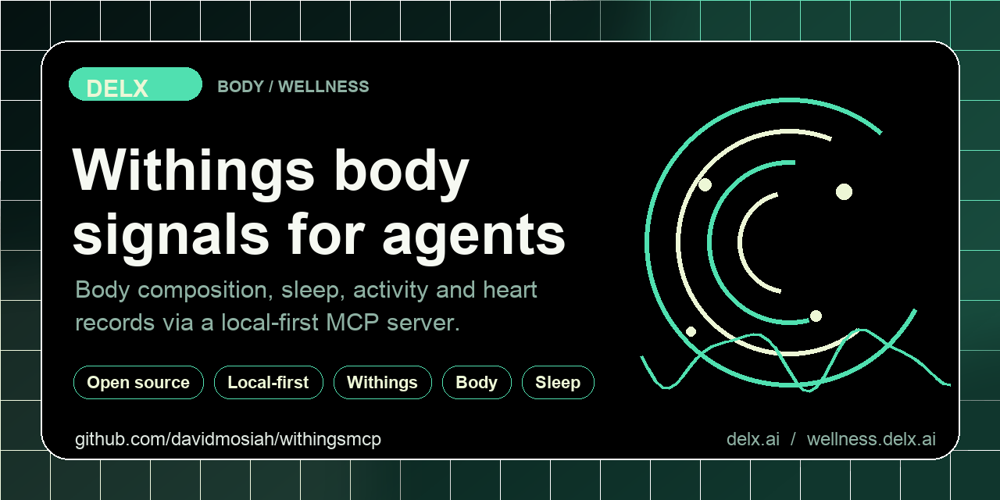

> Upgrading to 0.6.0: read the [migration guide](docs/migration-0.6.0.md) for local-only HTTP, disabled authenticated-response caching, and stricter input/profile limits.

<!-- delx-wellness header v2 -->
<h1 align="center">Withings MCP</h1>

<div align="center">
  
</div>

<h3 align="center">
  Give your AI agent your Withings body measures, sleep, activity and heart data &mdash; locally.<br>
  Local-first MCP server &mdash; <strong>tokens never leave your machine</strong>.
</h3>

<p align="center">
  <a href="https://www.npmjs.com/package/withings-mcp-unofficial"></a>
  <a href="https://github.com/davidmosiah/withings-mcp/releases/latest"></a>
  <a href="https://www.npmjs.com/package/withings-mcp-unofficial"></a>
  <a href="LICENSE"></a>
  <a href="https://wellness.delx.ai/connectors/withings"></a>
</p>

<p align="center">
  <a href="https://github.com/davidmosiah/withings-mcp/stargazers"></a>
  <a href="https://modelcontextprotocol.io"></a>
  <a href="https://github.com/davidmosiah/delx-wellness/blob/main/docs/release-index.md"></a>
  <a href="https://github.com/davidmosiah/delx-wellness-hermes"></a>
  <a href="https://github.com/davidmosiah/delx-wellness"></a>
</p>

> ⚡ **One-command install** with [Delx Wellness for Hermes](https://github.com/davidmosiah/delx-wellness-hermes):
> `npx -y delx-wellness-hermes setup` &mdash; preconfigures this connector and the other 8 in a dedicated Hermes profile.
>
> Or wire it standalone into Claude Desktop / Cursor / ChatGPT Desktop &mdash; see the install section below.

---

## HTTP (v2 stateless)

Default is **stdio**. Optional Streamable HTTP — no session id, JSON responses, loopback only:

```bash
npx -y withings-mcp-unofficial --http
# GET  http://127.0.0.1:3000/health
# POST http://127.0.0.1:3000/mcp   (sessionless)
```

Env: `WITHINGS_MCP_HOST`, `WITHINGS_MCP_PORT`, `WITHINGS_MCP_TRANSPORT=http`.


<!-- /delx-wellness header v2 -->

**Local-first MCP server that connects AI agents to your Withings body, sleep, activity and heart data.**

> **Unofficial project.** Not affiliated with, endorsed by or supported by Withings. Withings is a trademark of its respective owner. Use this only with your own Withings account and in line with the Withings Public API terms.

Built by [David Mosiah](https://github.com/davidmosiah) for people who use Claude, Cursor, Hermes, OpenClaw or other MCP-compatible agents to think about body composition, sleep and long-term health trends — without copy-pasting numbers from the Withings app.

Part of [Delx Wellness](https://github.com/davidmosiah/delx-wellness), a registry of local-first wellness MCP connectors.

> If this connector helps your agent workflow, please star the repo. Stars make the project easier for other AI builders to discover and help Delx keep shipping local-first wellness infrastructure.

## Why this exists

Withings has the longest-running consumer body-composition and sleep ecosystem (smart scales, Sleep Analyzer, ScanWatch). The data is rich — punctual weight + body fat + muscle mass measurements, sleep stages, ECG-grade heart records — but the Withings Public API uses a signed-token OAuth flow that's heavier than most consumer APIs.

This package handles the signed OAuth dance locally, normalizes responses, and exposes Withings through the Model Context Protocol. Tokens never leave your machine. Privacy-mode defaults keep raw payloads opt-in.

## Setup in 60 seconds

You'll need a Withings app ([create one here](https://account.withings.com/partner/dashboard_oauth2)) with redirect URI `http://127.0.0.1:3000/callback`.

```bash
npx -y withings-mcp-unofficial setup    # interactive: paste client id + secret
npx -y withings-mcp-unofficial auth     # opens browser, captures the OAuth code
npx -y withings-mcp-unofficial doctor   # verifies you're ready
```

Recommended scopes:

```text
user.activity user.metrics
```

Then add this to your MCP client config:

```json
{
  "mcpServers": {
    "withings": {
      "command": "npx",
      "args": ["-y", "withings-mcp-unofficial"]
    }
  }
}
```

For Claude Desktop, run `setup --client claude` and the snippet is written for you.

> **Note:** Withings OAuth authorization codes are short-lived (a few minutes). Don't pause between approving the consent screen and `withings_exchange_code` running.

## Try it with your agent

Three things to ask first:

```text
Use withings_connection_status to check setup, then run withings_daily_summary.
Give me a 5-line wellness brief for today.
```

```text
Call withings_weekly_summary with response_format=json. Identify my biggest
sleep/body bottleneck and give me a next-week plan.
```

```text
Use the withings_body_sleep_investigation prompt, after=2026-04-01.
Walk me through what changed in body composition + sleep.
```

## Data availability

This package uses the official Withings Public API. When this README says `raw`, it means the upstream Withings JSON for a supported endpoint — not raw device sensor streams.

| Data | Available | Notes |
|---|:---:|---|
| Body measures (weight, fat %, muscle, bone, water) | ✓ | Requires `user.metrics` scope |
| Daily activity (steps, calories, distance, intensity) | ✓ | Requires `user.activity` scope |
| Workouts + sport metadata | ✓ | Requires `user.activity` scope |
| Sleep summaries (duration, stages, efficiency, HR) | ✓ | Requires `user.activity` scope |
| Sleep detail records | ✓ | When the device exposes them |
| Heart records (ECG, BP, etc.) | ✓ | Requires `user.metrics` scope; varies by device/plan |
| Continuous sensor telemetry | — | Not exposed by Withings Public API |

## Tools

**Start with these:**

- `withings_connection_status` — verify local setup before calling Withings
- `withings_data_inventory` — inventory supported data domains, scopes, privacy modes and recommended first calls without calling Withings APIs.
- `withings_daily_summary` — body, sleep, activity and heart brief for today
- `withings_weekly_summary` — scorecard, comparison vs prior week, next-week plan

**Auth & diagnostics**

- `withings_capabilities`, `withings_agent_manifest`, `withings_privacy_audit`, `withings_cache_status`
- `withings_get_auth_url`, `withings_exchange_code`, `withings_revoke_access`

**Body & metrics**

- `withings_list_body_measures` — punctual weight/composition records. Use `after` / `before` as `YYYY-MM-DD` or ISO 8601 for large histories; the server sends Withings `startdate` / `enddate` (Unix seconds) upstream and caps returned records with `limit`.
- Date filters are action-aware: `getactivity` / `getworkouts` / sleep `getsummary` send civil `startdateymd` / `enddateymd`; `getmeas`, sleep detail, and heart list keep epoch `startdate` / `enddate`. Offset ISO instants keep their exact epoch conversion on epoch-style actions.
- `withings_list_heart` — heart records when device/plan permit

**Activity**

- `withings_list_activity` — daily activity summaries
- `withings_list_workouts` — logged workouts

**Sleep**

- `withings_list_sleep_summary` — daily sleep summaries with HR/stage fields
- `withings_list_sleep` — detailed sleep records

## Prompts

- `withings_daily_checkin` — practical daily health and body check-in
- `withings_weekly_review` — review trends across body, sleep, activity
- `withings_body_sleep_investigation` — investigate body measures + sleep together

## Resources

- `withings://capabilities`, `withings://agent-manifest`
- `withings://latest/activity`, `withings://latest/sleep`
- `withings://summary/daily`, `withings://summary/weekly`

## Privacy & security

- OAuth tokens are stored in `~/.withings-mcp/tokens.json` with `0600` permissions and are never returned by tools.
- Withings uses a signed-request OAuth flow — the package handles signing locally; client secrets never reach the MCP client.
- The server never prints access or refresh tokens.
- `WITHINGS_PRIVACY_MODE` defaults to `structured`. Raw Withings JSON is opt-in via `raw` mode or per-call override.
- Structured mode preserves complete upstream physiological fields, including future Withings additions, while removing GPS and secret-bearing values.
- `withings_revoke_access` clears local tokens; full account-side token revocation depends on your Withings plan.
- The MCP client never sees access or refresh tokens.
- This is **not medical advice**. Withings exposes data that may resemble medical signals (ECG, blood pressure) but this server is for personal AI workflows, not diagnosis or treatment.

## Configuration

`setup` writes most of these into `~/.withings-mcp/config.json` (`0600`). Manual env override is supported:

```bash
WITHINGS_CLIENT_ID=…
WITHINGS_CLIENT_SECRET=…
WITHINGS_REDIRECT_URI=http://127.0.0.1:3000/callback

# Optional
WITHINGS_SCOPES="user.activity user.metrics"
WITHINGS_PRIVACY_MODE=structured        # summary | structured | raw
WITHINGS_CACHE=sqlite                   # legacy setting; authenticated caching is disabled
WITHINGS_TOKEN_PATH=~/.withings-mcp/tokens.json
WITHINGS_CACHE_PATH=~/.withings-mcp/cache.sqlite
```

## Hermes / remote setup

```bash
npx -y withings-mcp-unofficial setup --client hermes --no-auth
npx -y withings-mcp-unofficial auth                      # run locally if browser auth is needed
npx -y withings-mcp-unofficial doctor --client hermes
hermes mcp test withings
```

After Hermes config changes, use `/reload-mcp` or `hermes mcp test withings`. Don't restart the gateway for normal data access.

If browser OAuth has to happen on a different machine than Hermes, run `auth` locally and copy `~/.withings-mcp/tokens.json` to the server with `chmod 600`.

## Requirements

- Node.js 20+
- A Withings app at <https://account.withings.com/partner/dashboard_oauth2> with redirect URI `http://127.0.0.1:3000/callback`

## Development

```bash
git clone https://github.com/davidmosiah/withings-mcp.git
cd withings-mcp
npm install
npm test
npm run build
```

Test with MCP Inspector:

```bash
npx @modelcontextprotocol/inspector node dist/index.js
```

## Links

- npm: <https://www.npmjs.com/package/withings-mcp-unofficial>
- Docs site: <https://wellness.delx.ai/connectors/withings>
- Legacy docs: <https://withingsmcp.vercel.app/>
- GitHub: <https://github.com/davidmosiah/withings-mcp>
- Delx Wellness registry: <https://github.com/davidmosiah/delx-wellness>
- Connector quality standard: <https://github.com/davidmosiah/delx-wellness/blob/main/docs/connector-quality-standard.md>
- Withings Public API docs: <https://developer.withings.com/api-reference/>

<!-- delx-wellness see-also -->

## See also

The full [Delx Wellness](https://wellness.delx.ai) connector library:

| Provider | Package | Repo |
|---|---|---|
| WHOOP | [`whoop-mcp-unofficial`](https://www.npmjs.com/package/whoop-mcp-unofficial) | [whoop-mcp](https://github.com/davidmosiah/whoop-mcp) |
| Oura | [`oura-mcp-unofficial`](https://www.npmjs.com/package/oura-mcp-unofficial) | [ouramcp](https://github.com/davidmosiah/ouramcp) |
| Garmin | [`garmin-mcp-unofficial`](https://www.npmjs.com/package/garmin-mcp-unofficial) | [garminmcp](https://github.com/davidmosiah/garminmcp) |
| Strava | [`strava-mcp-unofficial`](https://www.npmjs.com/package/strava-mcp-unofficial) | [strava-mcp](https://github.com/davidmosiah/strava-mcp) |
| Fitbit | [`fitbit-mcp-unofficial`](https://www.npmjs.com/package/fitbit-mcp-unofficial) | [fitbitmcp](https://github.com/davidmosiah/fitbitmcp) |
| Withings | [`withings-mcp-unofficial`](https://www.npmjs.com/package/withings-mcp-unofficial) | [withings-mcp](https://github.com/davidmosiah/withings-mcp) |
| Apple Health | [`apple-health-mcp-unofficial`](https://www.npmjs.com/package/apple-health-mcp-unofficial) | [apple-health-mcp](https://github.com/davidmosiah/apple-health-mcp) |
| Polar | [`polar-mcp-unofficial`](https://www.npmjs.com/package/polar-mcp-unofficial) | [polarmcp](https://github.com/davidmosiah/polarmcp) |
| Nourish (nutrition) | [`wellness-nourish`](https://www.npmjs.com/package/wellness-nourish) | [wellness-nourish](https://github.com/davidmosiah/wellness-nourish) |

**One-command setup for Hermes** — preconfigures every connector above plus wellness skills + onboarding: [`delx-wellness-hermes`](https://github.com/davidmosiah/delx-wellness-hermes).

<!-- /delx-wellness see-also -->

## 📧 Contact & Support

- 📨 **support@delx.ai** — general questions, integration help, partnerships
- 🐛 **Bug reports / feature requests** — [GitHub Issues](https://github.com/davidmosiah/withings-mcp/issues)
- 🐦 **Updates** — [@delx369](https://x.com/delx369) on X
- 🌐 **Site** — [wellness.delx.ai](https://wellness.delx.ai)


## License

MIT — see [LICENSE](LICENSE).

## Disclaimer

This software is provided as-is. It is not a medical device, does not provide medical advice, and should not be used for diagnosis or treatment. Withings exposes data that may resemble medical signals (ECG, blood pressure, body composition) — always consult qualified professionals for medical concerns.

## Skill or MCP

Same package, two doors. MCP registers tools on stdio/HTTP. The [skill](skill/SKILL.md) can drive the **same** tools through the CLI when the client has no MCP:

```bash
npx -y withings-mcp-unofficial call withings_connection_status --json '{}'
```

Copy `skill/SKILL.md` into your agent skills dir.

### Authenticated response cache safety

Authenticated health responses always reach the provider and are never cached or
replaced by a previous success when the provider fails. This includes account
changes, expired/revoked credentials and transient failures. `WITHINGS_CACHE` is
retained for configuration compatibility, but cannot enable this unsafe fallback.
Legacy SQLite files are not opened, read, changed or deleted by requests or cache
status checks. They may still contain historical health data: remove them manually
when no longer needed. Generic HTTP caching also bypasses Authorization,
Proxy-Authorization and Cookie headers, case-insensitively.

### Body-measure values and timestamps

`withings_list_body_measures` requests real measurements (`category=1`), not
user goals. Structured and summary body-measure groups include `measured_at`
(UTC ISO 8601) and decoded measures: `decoded_value = value * 10 ** unit`, with
documented `label` and `unit_label` for known types. Original value, exponent,
type and future fields remain intact. Types without a documented unit (such as
vascular age) and unknown types retain their numeric data without a guessed
unit; raw JSON remains unchanged. Markdown previews display decoded scale values
and units instead of the generic activity fields. Measurement type units follow
the [official API reference](https://developer.withings.com/api-reference/#operation/measure-getmeas).

### Token rotation and API failures

Before upgrading or rolling back across the token-lock change, stop **all**
instances that share the token file. The older `.lock` and newer `.lock.sqlite`
implementations do not coordinate with each other; never run them together.
Follow the [coordinated upgrade and rollback procedure](docs/migration-0.6.0.md#token-lock-upgrades-and-rollbacks).

Token records retain the Withings `userid`. Refreshes serialize across processes
using an OS-held SQLite lock (the existing SQLite dependency), which releases
automatically after a process crash. New credentials are flushed and atomically
replaced before use. HTTP 401 and the JSON invalid-token statuses 100, 101, 102,
200 and 401 trigger one refresh; concurrent rejected requests reuse a rotation that
already completed. Incomplete token responses or a changed user identity leave
saved credentials intact. Signed token requests are never replayed automatically.

Authenticated API failures remain errors, including transient failures; no earlier response is substituted.

### Token encryption at rest

Set the optional environment-only `WITHINGS_TOKEN_ENCRYPTION_KEY` to a secret
32-byte key encoded as unpadded base64url to encrypt token files with AES-256-GCM.
Keep the key in a secret manager outside the token volume. Files use the
`withings-token-v1` JSON envelope: a 12-byte base64url `nonce` and base64url
`ciphertext` with the 16-byte authentication tag appended; the format name is
authenticated as additional data. Writes remain atomic and synchronized.
Normal reads and refreshes fail explicitly for wrong/missing keys, modified
ciphertext, or plaintext files when encryption is enabled. Explicit OAuth
reauthorization instead replaces the token file under the lock using that
process's configured key, or plaintext if the variable is unset; it does not
need to decrypt the previous file. The lock serializes writes but does not enforce
a shared encryption policy. All processes sharing a token file must use the same
key, or all leave it unset. Protect and back up the key separately from tokens;
losing it requires reauthorization. An empty `WITHINGS_TOKEN_ENCRYPTION_KEY=""`
is invalid, not equivalent to an unset variable.

For a new connection, configure encryption before authorizing. To enable
encryption on an existing store, rotate the key, recover from a lost key, or
deliberately return to plaintext, use this coordinated transition:

The bundled Agent Plugin (`agent-plugin/mcp.json`) currently pins
`withings-mcp-unofficial@0.5.5`, which lacks encryption support and uses the older
`.lock` implementation. Do not run that pinned executable against a token file
shared with this build; keep it stopped until its executable has been explicitly
verified as compatible with the intended encryption mode and lock implementation.

1. Stop **all** processes sharing the token file, including MCP clients, HTTP
   helpers and scheduled jobs. Pause automatic restarts; do not run competing
   authorization or refresh operations during the transition.
2. While stopped, configure every client's environment with the same intended
   key, or unset the variable everywhere only for a deliberate plaintext rollback.
   Check that every configured executable supports the intended format and uses
   the same lock implementation. If changing builds, also follow the
   [token-lock upgrade and rollback procedure](docs/migration-0.6.0.md#token-lock-upgrades-and-rollbacks).
3. Keep the current token file and OAuth client configuration; do not delete
   credentials or restore an older token backup. With all other instances still
   stopped, run `withings-mcp-server auth` once using the intended build,
   environment and token path, and authorize the intended Withings account.
   This command requires the configured local HTTP callback; for other redirect
   setups, use `withings_get_auth_url` then `withings_exchange_code` in a single
   deliberately started instance with the same configuration. Successful
   reauthorization replaces the store with fresh provider credentials in the
   intended format; merely changing the environment does not convert the file.
4. Check `withings-mcp-server doctor --strict` with each client's intended configuration
   to confirm the token file is readable before restarting clients and restoring
   automatic restarts. If authorization or validation fails, keep other clients
   stopped and resolve the error before resuming; do not restore stale tokens
   after provider credentials may have rotated.

Encryption does not protect existing plaintext copies or backups. Keep those
protected separately; a deliberate plaintext rollback also removes encryption
at rest from subsequent token writes.
